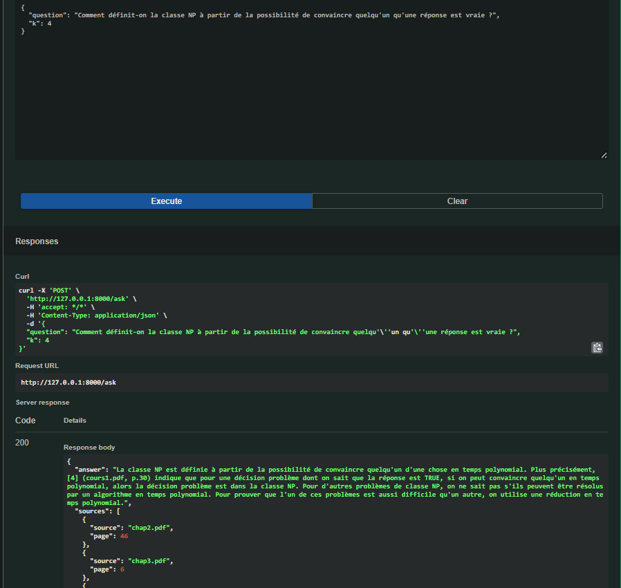

# RAG Assistant : questions-réponses sur des cours en PDF

Assistant de questions-réponses qui répond **uniquement à partir de documents PDF**, en citant le fichier et la page d'où vient chaque réponse. Le projet couvre toute la chaîne : indexation des documents, recherche sémantique, génération avec un LLM local, API web, et **évaluation chiffrée** de la qualité de la recherche.

> Projet personnel d'autoformation (RAG : *Retrieval-Augmented Generation*).
> Corpus utilisé : 3 cours de l'école d'ingénieurs (recherche opérationnelle, régressions, bases de données), en français et en anglais.

## Capture d'écran




## Comment ça marche

```
INDEXATION (une fois)                     QUESTION (à chaque requête)
ingest.py                                 rag.py + api.py

PDF                                       Question
 ↓ extraction du texte par page            ↓ embedding de la question
Texte                                     Recherche des k chunks les plus proches (Chroma)
 ↓ découpage en chunks                     ↓
Chunks                                    Prompt = consigne + chunks + question
 ↓ embeddings                              ↓
Vecteurs + texte + (fichier, page)        LLM local (Ollama) → réponse + sources
 ↓
Base vectorielle Chroma (chroma_db/)
```

Le LLM ne connaît pas les documents : tout ce qu'il sait vient des passages insérés dans le prompt. La consigne lui demande de répondre **uniquement** avec ce contexte et de dire « Je ne sais pas d'après les documents » quand l'information n'y est pas.

## Choix techniques

| Élément | Choix | Pourquoi |
|---|---|---|
| Extraction PDF | `pypdf`, page par page | conserve le numéro de page pour citer les sources |
| Découpage | chunks de 800 caractères, chevauchement de 150 | compromis testé (voir Évaluation) ; le chevauchement évite de couper une idée en deux |
| Embeddings | `intfloat/multilingual-e5-small` (vecteurs de 384 dimensions) | multilingue (cours en français et en anglais), léger, tourne sur CPU |
| Base vectorielle | Chroma (persistante sur disque), similarité cosinus | simple, sans serveur à installer |
| LLM | `qwen2.5:3b` via Ollama | gratuit, local, aucune clé API |
| API | FastAPI + Pydantic | validation des entrées/sorties et documentation automatique |

## Structure du projet

```
rag-assistant/
├── data/pdfs/            # tes PDF (non versionnés)
├── ingest.py             # indexation : PDF -> chunks -> vecteurs -> Chroma
├── rag.py                # retrieve() : recherche ; answer() : prompt + LLM
├── api.py                # API FastAPI (POST /ask)
├── eval.py               # évaluation du retrieval (hit rate@k, MRR)
├── eval_questions.json   # jeu de test : question + fichier + page attendue
├── results.csv           # résultats des comparaisons de configurations
├── requirements.txt
└── README.md
```

## Installation

Prérequis : Python 3.10+ et [Ollama](https://ollama.com).

```powershell
# Windows PowerShell
py -m venv .venv
.venv\Scripts\Activate.ps1
pip install -r requirements.txt

ollama pull qwen2.5:3b
```

Sous Linux / macOS : `python -m venv .venv`, puis `source .venv/bin/activate`.

## Utilisation

1. **Ajoute tes PDF** dans `data/pdfs/` (des PDF avec du texte sélectionnable, pas des scans).
2. **Indexe-les** (une seule fois, ou après tout changement de documents ou de découpage) :
   ```powershell
   python ingest.py
   ```
3. **Lance l'API** :
   ```powershell
   uvicorn api:app --reload
   ```
4. **Pose une question** depuis `http://127.0.0.1:8000/docs` (bloc `POST /ask`, « Try it out »), ou en ligne de commande :
   ```powershell
   $body = @{ question = "Ta question"; k = 4 } | ConvertTo-Json
   Invoke-RestMethod -Uri http://127.0.0.1:8000/ask -Method Post `
     -ContentType "application/json; charset=utf-8" `
     -Body ([System.Text.Encoding]::UTF8.GetBytes($body)) | ConvertTo-Json -Depth 5
   ```

Forme de la réponse :

```json
{
  "answer": "Réponse rédigée par le LLM, avec références [1], [2]…",
  "sources": [
    { "source": "nom_du_cours.pdf", "page": 12 }
  ]
}
```

Si Ollama n'est pas lancé ou si le modèle n'est pas téléchargé, `/ask` renvoie une erreur 500.

## Évaluation

L'évaluation mesure la **qualité de la recherche** (sans LLM) : pour chaque question du jeu de test, la bonne page est-elle parmi les k passages renvoyés ?

- **Jeu de test** : 26 questions (10 sur la recherche opérationnelle, 7 sur les régressions, 9 sur les bases de données), chacune associée au fichier et à la page contenant la réponse. Les questions sont rédigées en français, y compris sur les cours en anglais.
- **Construction** : les questions ont été rédigées à partir du texte des cours avec l'aide d'un assistant IA, puis chaque page attendue a été contrôlée par recherche de mots-clés. [À COMPLÉTER : « J'ai en plus vérifié N questions à la main dans les PDF. »]
- **Métriques** : *hit rate@k* (part des questions dont la bonne page est dans les k premiers résultats) et *MRR* (récompense les bonnes pages bien classées).

```powershell
python eval.py 800/150      # affiche les résultats et ajoute une ligne à results.csv
```

### Résultats

Comparaison de la taille des chunks (en caractères, chevauchement d'environ 19 %) :

| Chunks (taille / chevauchement) | Nb de chunks | hit@1 | hit@3 | hit@5 | MRR |
|---|---|---|---|---|---|
| 400 / 75 | 450 |  58 % | 85 % | 92 % | [ ] |
| **800 / 150** | 450 | 58 % | 85 % | 88 % | [ ] |
| 1500 / 280 | 450 | 58 % | 85 % | 88 % | [ ] |

[À COMPLÉTER : une ou deux phrases de conclusion, par exemple quelle taille de chunk donne le meilleur compromis et pourquoi.]

### Qualité des réponses

[À COMPLÉTER après relecture manuelle : sur N questions posées via `/docs`, X réponses correctes, Y partielles, Z fausses ; comportement sur 3 questions hors sujet (« Je ne sais pas d'après les documents » attendu).]

## Limites

- **Petit jeu de test** (26 questions, 3 documents) : un seul échec change le score de près de 4 points. Les résultats décrivent ce corpus, pas une performance générale.
- **Notation stricte** : seule la page exacte compte. Les diapositives consécutives qui répètent le même texte sont comptées fausses même si la page voisine contient la réponse.
- **Extraction PDF** : les formules, schémas et tableaux sous forme d'images ne sont pas extraits, donc absents de la base.
- **Qualité du LLM** : un modèle local de 3 milliards de paramètres peut déformer le contexte ou répondre de manière incomplète. L'évaluation automatique ne mesure que la recherche.
- **Les `sources` renvoyées** sont celles des passages récupérés, pas nécessairement celles que le LLM a effectivement utilisées.
- **Pas d'authentification** ni de gestion de plusieurs utilisateurs : projet d'apprentissage, pas un service de production.

## Pistes d'amélioration

- Ajouter un **reranker** pour améliorer le classement (hit@1).
- **Recherche hybride** (vecteurs + mots-clés BM25) pour les termes exacts et les sigles.
- Découpage par phrases ou par titres plutôt qu'à longueur fixe.
- Seuil de distance pour refuser de répondre quand aucun passage n'est proche.
- Évaluation de la **réponse générée** (fidélité aux sources), pas seulement de la recherche.
- Version de la chaîne avec LangChain pour comparaison.

## Notes

- Les PDF de cours ne sont pas inclus dans le dépôt (documents pédagogiques non publics) ; `eval_questions.json` fait référence aux trois fichiers d'origine. Pour reproduire l'évaluation, il faut fournir tes propres PDF et adapter le jeu de test.
- La base `chroma_db/` est régénérée par `ingest.py` et n'est pas versionnée.
