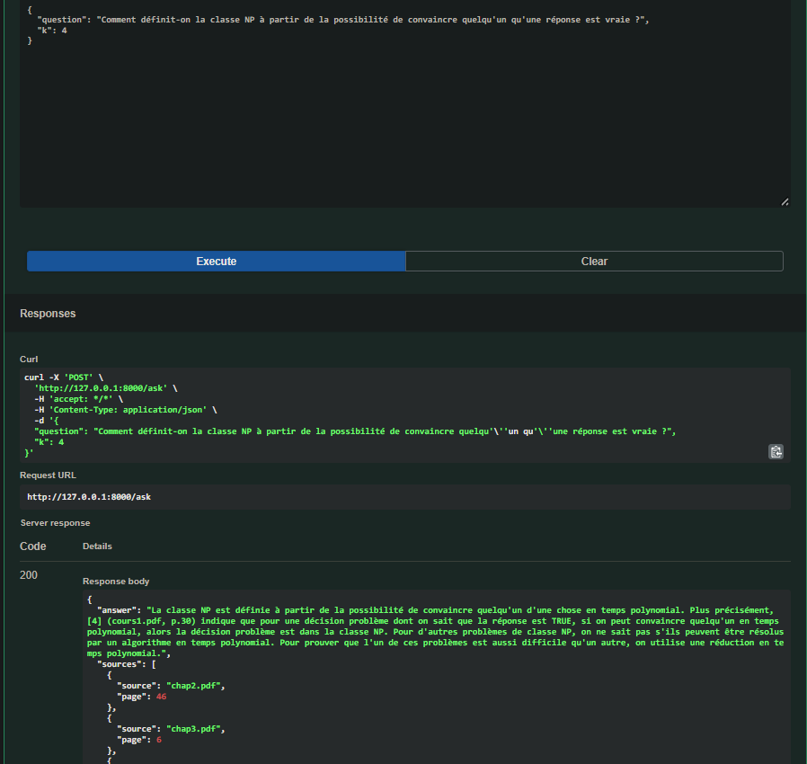

# RAG Assistant : questions-réponses sur des cours en PDF

Assistant de questions-réponses qui répond **uniquement à partir de documents PDF**, en citant le fichier et la page d'où vient chaque réponse. Le projet couvre toute la chaîne : indexation des documents, recherche sémantique, **reranking**, génération avec un LLM (local via Ollama ou **Claude** via l'API Anthropic), API web, et **évaluation chiffrée** de la qualité de la recherche.

> Projet personnel d'autoformation (RAG : *Retrieval-Augmented Generation*).
> Corpus : 13 cours de l'école d'ingénieurs (recherche opérationnelle, data mining / régressions, bases de données), en français et en anglais.

**Résultat principal** : l'ajout d'un reranker cross-encoder fait passer la bonne page en 1re position de **58 % à 92 %** des questions (MRR 0.69 → 0.96), pour environ 1 s de calcul en plus par question sur CPU.

## Capture d'écran




## Comment ça marche

```
INDEXATION (une fois)                     QUESTION (à chaque requête)
ingest.py                                 rag.py + api.py

PDF                                       Question
 ↓ extraction du texte par page            ↓ embedding de la question
Texte                                     20 chunks les plus proches (Chroma)
 ↓ découpage en chunks                     ↓
Chunks                                    Reranker : relit chaque paire (question, chunk)
 ↓ embeddings                              et garde les k meilleurs
Vecteurs + texte + (fichier, page)         ↓
 ↓                                        Prompt = consigne + chunks + question
Base vectorielle Chroma (chroma_db/)       ↓
                                          LLM (Ollama ou Claude) → réponse + sources
```

Le LLM ne connaît pas les documents : tout ce qu'il sait vient des passages insérés dans le prompt. La consigne lui demande de répondre **uniquement** avec ce contexte et de dire « Je ne sais pas d'après les documents » quand l'information n'y est pas.

**Pourquoi un reranker ?** Les embeddings comparent deux vecteurs calculés séparément (question d'un côté, passage de l'autre) : c'est rapide, mais approximatif. Un cross-encoder lit la question **et** le passage ensemble, ce qui est plus précis mais trop lent pour toute la base. On combine donc les deux : les embeddings trouvent 20 candidats, le cross-encoder les reclasse.

## Choix techniques

| Élément | Choix | Pourquoi |
|---|---|---|
| Extraction PDF | `pypdf`, page par page | conserve le numéro de page pour citer les sources |
| Découpage | chunks de 800 caractères, chevauchement de 150 | le chevauchement évite de couper une idée en deux |
| Embeddings | `intfloat/multilingual-e5-small` (384 dimensions) | multilingue (cours en français et en anglais), léger, tourne sur CPU |
| Base vectorielle | Chroma (persistante sur disque), similarité cosinus | simple, sans serveur à installer |
| Reranker | `cross-encoder/mmarco-mMiniLMv2-L12-H384-v1` | multilingue, gros gain mesuré (voir Évaluation) |
| Recherche mots-clés | BM25 (`rank_bm25`), fusion par Reciprocal Rank Fusion | testée, mais pas retenue par défaut (voir Évaluation) |
| LLM | `qwen2.5:3b` via Ollama (par défaut) ou Claude via l'API Anthropic | Ollama : gratuit et local ; Claude : réponses de bien meilleure qualité |
| API | FastAPI + Pydantic | validation des entrées/sorties, documentation automatique, erreurs 503 claires si le LLM est indisponible |

## Structure du projet

```
rag-assistant/
├── data/pdfs/            # tes PDF (non versionnés)
├── ingest.py             # indexation : PDF -> chunks -> vecteurs -> Chroma
├── rag.py                # retrieve() : recherche + reranking ; answer() : prompt + LLM
├── api.py                # API FastAPI (POST /ask)
├── eval.py               # évaluation du retrieval (hit rate@k, MRR) sur 6 configurations
├── eval_questions.json   # jeu de test : question + fichier + page attendue
├── results.csv           # résultats des comparaisons
├── requirements.txt
└── README.md
```

## Installation

Prérequis : Python 3.10+, et au choix [Ollama](https://ollama.com) ou une clé API Anthropic.

```powershell
# Windows PowerShell
py -m venv .venv
.venv\Scripts\Activate.ps1
pip install -r requirements.txt

ollama pull qwen2.5:3b        # si tu utilises Ollama
```

Sous Linux / macOS : `python -m venv .venv`, puis `source .venv/bin/activate`.

### Choisir le LLM

Par défaut le projet utilise Ollama. Pour utiliser Claude :

```powershell
$env:LLM_PROVIDER = "claude"
$env:ANTHROPIC_API_KEY = "ta-clé"         # à créer sur console.anthropic.com
# optionnel : $env:CLAUDE_MODEL = "claude-sonnet-5-5"  (défaut : claude-opus-5-5)
```

On peut aussi choisir le fournisseur à chaque requête avec le champ `provider` de `/ask`.

## Utilisation

1. **Ajoute tes PDF** dans `data/pdfs/` (des PDF avec du texte sélectionnable, pas des scans).
2. **Indexe-les** (après tout changement de documents ou de découpage ; la base est recréée à chaque fois) :
   ```powershell
   python ingest.py              # chunks de 800 / chevauchement 150
   python ingest.py 1500 280     # autre découpage
   ```
3. **Lance l'API** :
   ```powershell
   uvicorn api:app --reload
   ```
4. **Pose une question** depuis `http://127.0.0.1:8000/docs` (bloc `POST /ask`, « Try it out »), ou en ligne de commande :
   ```powershell
   $body = @{ question = "Ta question"; k = 4 } | ConvertTo-Json
   Invoke-RestMethod -Uri http://127.0.0.1:8000/ask -Method Post `
     -ContentType "application/json; charset=utf-8" `
     -Body ([System.Text.Encoding]::UTF8.GetBytes($body)) | ConvertTo-Json -Depth 5
   ```

Paramètres de `/ask` :

| Champ | Défaut | Rôle |
|---|---|---|
| `question` | (obligatoire) | la question |
| `k` | 4 | nombre de passages donnés au LLM (1 à 10) |
| `mode` | `dense` | `dense`, `bm25` ou `hybrid` |
| `rerank` | `true` | reclasser les candidats avec le cross-encoder |
| `provider` | variable `LLM_PROVIDER` | `ollama` ou `claude` |

Forme de la réponse :

```json
{
  "answer": "Réponse rédigée par le LLM, avec références [1], [2]…",
  "sources": [
    { "source": "nom_du_cours.pdf", "page": 12 }
  ]
}
```

Si le LLM est indisponible (Ollama éteint, clé Anthropic absente ou invalide…), `/ask` renvoie une erreur **503** avec un message explicite.

## Évaluation

L'évaluation mesure la **qualité de la recherche** (sans LLM) : pour chaque question du jeu de test, la bonne page est-elle parmi les k passages renvoyés ?

- **Jeu de test** : 26 questions (10 sur la recherche opérationnelle, 7 sur les régressions, 9 sur les bases de données), chacune associée au fichier et à la page contenant la réponse. Les questions sont rédigées en français, y compris sur les cours en anglais.
- **Corpus** : les 13 PDF sont indexés (662 chunks), pas seulement les 3 visés par les questions : les 10 autres cours jouent le rôle de **distracteurs**, comme dans un vrai usage.
- **Construction** : les questions ont été rédigées à partir du texte des cours avec l'aide d'un assistant IA, puis chaque page attendue a été contrôlée par recherche de mots-clés.
- **Métriques** : *hit rate@k* (part des questions dont la bonne page est dans les k premiers résultats) et *MRR* (récompense les bonnes pages bien classées).

```powershell
python eval.py                  # tableau des 6 configurations
python eval.py --misses         # + détail des questions ratées
python eval.py --save 800/150   # + ajoute les lignes à results.csv
```

### Résultats : méthode de recherche

Chunks 800 / 150, 13 PDF, 662 chunks :

| Recherche | hit@1 | hit@3 | hit@5 | MRR |
|---|---|---|---|---|
| dense (embeddings seuls, ancienne version) | 58 % | 85 % | 85 % | 0.69 |
| BM25 (mots-clés seuls) | 19 % | 38 % | 38 % | 0.28 |
| hybride (dense + BM25, RRF) | 38 % | 73 % | 81 % | 0.56 |
| **dense + rerank** (par défaut) | **92 %** | **100 %** | **100 %** | **0.96** |
| BM25 + rerank | 35 % | 38 % | 38 % | 0.37 |
| hybride + rerank | 85 % | 92 % | 92 % | 0.88 |

Temps de recherche moyen (CPU) : 21 ms par question sans reranker, environ 1 s avec.

**Ce qu'on en retient :**
- **Le reranker est le changement le plus rentable** : +34 points de hit@1. Les 20 candidats des embeddings contiennent presque toujours la bonne page ; le problème était surtout son **classement**.
- **BM25 fait baisser les scores**, contrairement à ce que j'attendais. Explication probable : les questions sont en français alors qu'une partie des cours est en anglais. BM25 compare des mots exacts, donc il ne peut pas relier « relaxation continue » à *continuous relaxation*, alors que les embeddings multilingues le peuvent. La fusion hybride ajoute alors surtout du bruit.
- Conclusion : la recherche hybride n'est pas une amélioration automatique. Il faut la mesurer sur son propre corpus.

### Historique : taille des chunks

Mesuré avant l'ajout du reranker, sur l'ancien corpus de 3 PDF :

| Chunks (taille / chevauchement) | Nb de chunks | hit@1 | hit@3 | hit@5 | MRR |
|---|---|---|---|---|---|
| 400 / 75 | 696 | 54 % | 77 % | 88 % | 0.66 |
| 800 / 150 | 450 | 58 % | 85 % | 92 % | 0.72 |
| 1500 / 280 | 369 | 58 % | 92 % | 96 % | 0.74 |

### Qualité des réponses

Avec Ollama (`qwen2.5:3b`), avant reranker : sur 10 questions posées via `/docs`, 7 réponses correctes, 3 partielles, 0 fausses ; sur 3 questions hors sujet, réponse « Je ne sais pas d'après les documents ».

## Limites

- **Petit jeu de test** (26 questions) : un seul échec change le score de près de 4 points. Les résultats décrivent ce corpus, pas une performance générale. Le score de 100 % à hit@5 ne veut pas dire que la recherche est parfaite.
- **Questions rédigées avec l'aide d'une IA** à partir du texte des cours : elles reprennent peut-être le vocabulaire des pages plus fidèlement que de vraies questions d'étudiants.
- **Notation stricte** : seule la page exacte compte. Les diapositives consécutives qui répètent le même texte sont comptées fausses même si la page voisine contient la réponse.
- **Extraction PDF** : les formules, schémas et tableaux sous forme d'images ne sont pas extraits, donc absents de la base.
- **Qualité du LLM** : un modèle local de 3 milliards de paramètres peut déformer le contexte ou répondre de manière incomplète. L'évaluation automatique ne mesure que la recherche.
- **Les `sources` renvoyées** sont celles des passages récupérés, pas nécessairement celles que le LLM a effectivement utilisées.
- **Pas d'authentification** ni de gestion de plusieurs utilisateurs : projet d'apprentissage, pas un service de production.

## Pistes d'amélioration

- Évaluation de la **réponse générée** (fidélité aux sources), par exemple avec Claude comme juge, et comparaison Ollama / Claude.
- Interface de démo (Streamlit ou Gradio) et image **Docker**.
- Découpage par phrases ou par titres plutôt qu'à longueur fixe ; refaire la comparaison des tailles de chunks avec le reranker.
- Seuil sur le score du reranker pour refuser de répondre quand aucun passage n'est pertinent.
- Utiliser les **citations natives** de l'API Claude pour savoir quels passages ont réellement servi.
- Jeu de test plus grand, avec des questions écrites à la main.

## Notes

- Les PDF de cours ne sont pas inclus dans le dépôt (documents pédagogiques non publics) ; `eval_questions.json` fait référence à `cours1.pdf`, `chap2.pdf` et `CM1DB.pdf`. Pour reproduire l'évaluation, il faut fournir tes propres PDF et adapter le jeu de test.
- La base `chroma_db/` est régénérée par `ingest.py` et n'est pas versionnée.
- Au premier lancement, les modèles d'embeddings et de reranking (~950 Mo au total) sont téléchargés depuis Hugging Face.
